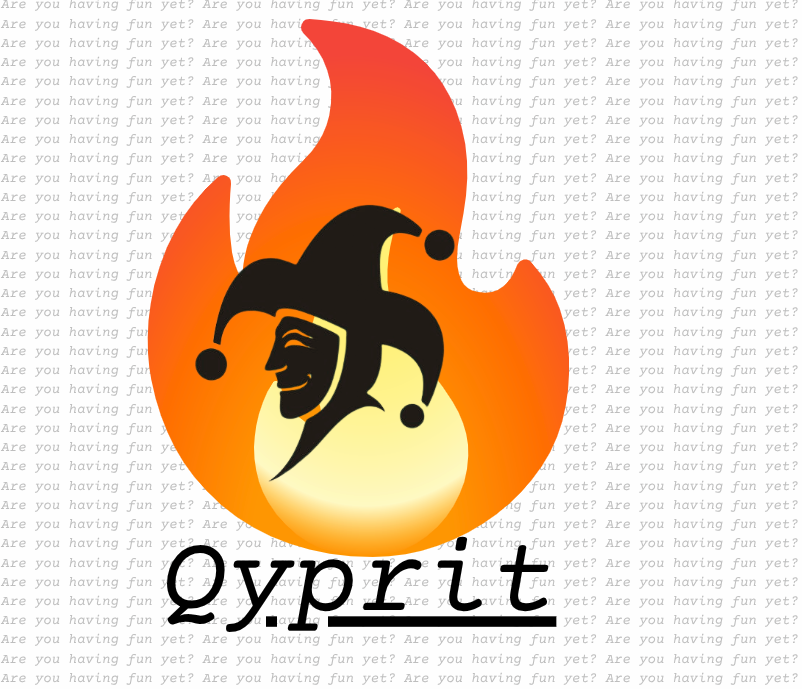

# Qyprit

<p align="center">



</p>

A simple command line application similar to PGP but with encription algorithms that are quantum safe.

Here is the usage

```
Qyprit version: 1.0.0
Made by ranon-rat

USAGE:
  qyprit <command> [options]

GLOBAL:
  -p, --password <pass>      Password for the private PEM (on create or load)
  -h, --help                 Show this help
  -v, --version              Show version

SETUP:
  --setup                    Create ~/.qyprit/ and its subdirectories

IDENTITIES (your private keys):
  --new-identity <name>      Create a new identity (use -p for the password)
  --remove-identity <name>   Remove an existing identity
  --list-identities          List your identities
  --identity <name>          Select your identity to sign / decrypt / show pubkey
  --public-key               With --identity prints your pubkey; with --friend the friend's

FRIENDS (other people's public keys):
  --new-friend <name>        Add or update a friend by pasting their pubkeys
  --remove-friend <name>     Remove a friend
  --list-friend              List your friends
  --friend <name>            Select a friend to encrypt / verify

ACTIONS:
  -s, --sign                 Sign a message         (requires --identity)
  --verify                   Verify a signature     (requires --friend)
  -e, --encrypt              Encrypt and sign       (requires --identity and --friend)
  --decrypt                  Decrypt and verify     (requires --identity and --friend)

EXAMPLES:
  qyprit --setup
  qyprit --new-identity alice -p "my_pass"
  qyprit --identity alice --sign
  qyprit --identity alice --friend bob --encrypt
  qyprit --identity alice --friend bob --decrypt
  qyprit --friend bob --verify
  qyprit --identity alice --public-key
```
